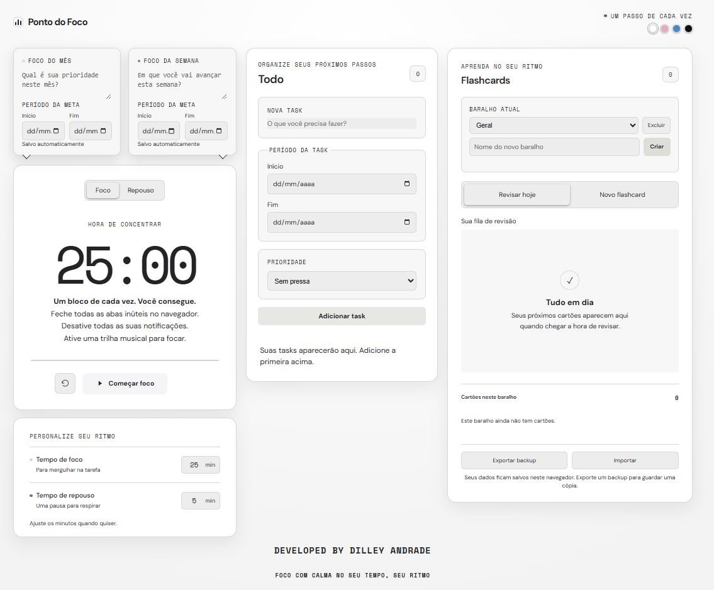
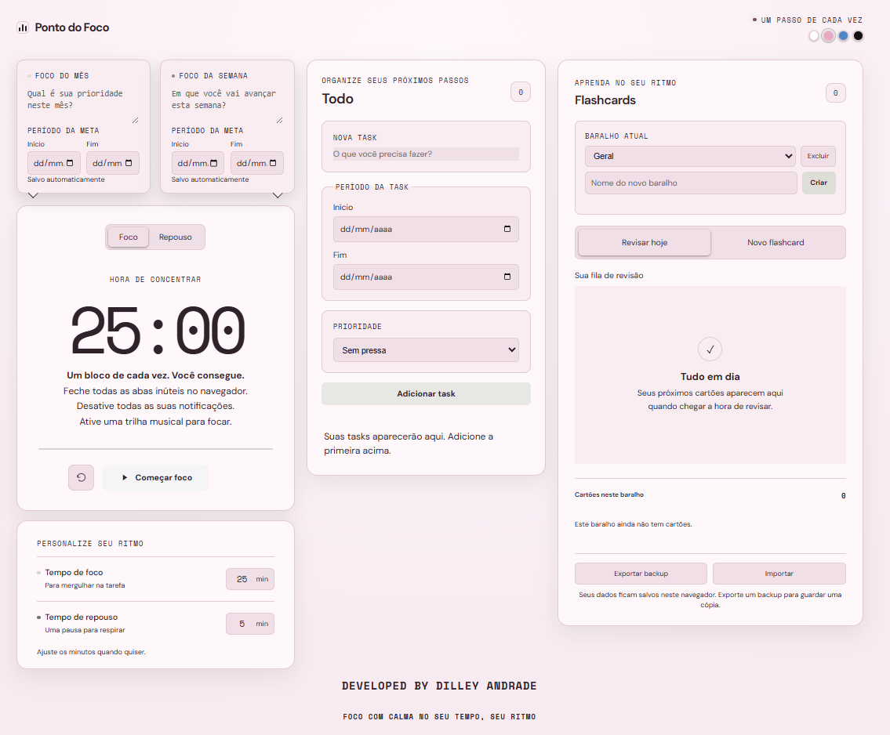
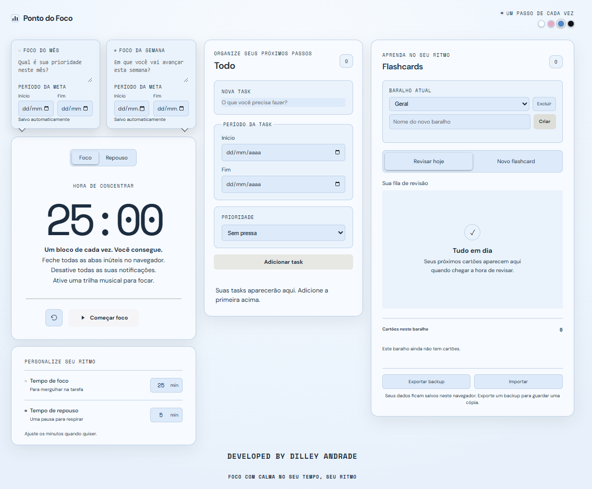
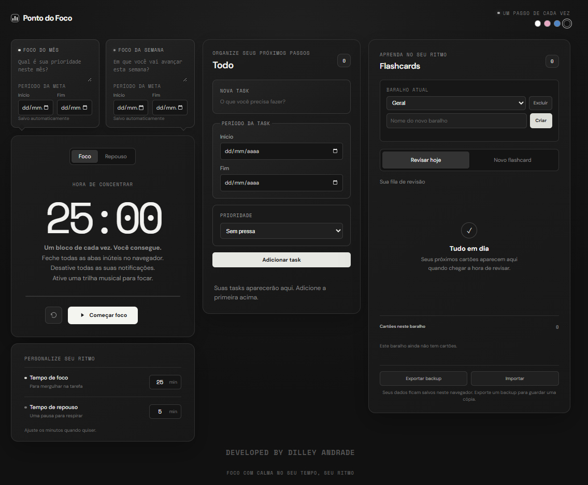

# Ponto do Foco

O **Ponto do Foco** é uma iniciativa do engenheiro de dados **Dilley Andrade**, criada para melhorar sua produtividade e organização no dia a dia. A aplicação reúne ferramentas para planejar prioridades, organizar tarefas, manter períodos de concentração e apoiar a revisão de conteúdos em um só lugar.

## Visão geral

O Ponto do Foco funciona diretamente no navegador e combina quatro áreas de trabalho:

- **Temporizador Pomodoro:** alterna entre períodos de foco e repouso. Os tempos começam em 25 e 5 minutos, podem ser ajustados (de 1 a 180 minutos para foco e de 1 a 60 para repouso) e o temporizador pode ser iniciado, pausado ou reiniciado. Ao concluir uma etapa, um sinal sonoro é emitido quando o navegador oferece suporte e a etapa seguinte é selecionada.
- **Metas de foco:** permite registrar prioridades do mês e da semana, com datas de início e fim. As alterações são salvas automaticamente.
- **Tasks:** permite adicionar, editar e excluir tarefas com período e prioridade (urgente, atenção ou sem pressa). A lista é ordenada por prioridade e prazo, e mostra a situação do prazo em relação à data atual.
- **Flashcards:** organiza cartões em baralhos, com frente e verso, fila diária de revisão e biblioteca por baralho. Ao marcar um cartão como fácil, a próxima revisão é programada em intervalos crescentes de 3, 7, 15 e até 30 dias. Ao marcar que errou, ele volta para a fila após um dia. Um cartão novo aparece para revisão após 24 horas.

A interface também oferece quatro temas visuais: branco, rosa, azul e preto.

## Prévia dos temas

| Tema branco | Tema rosa |
| --- | --- |
|  |  |

| Tema azul | Tema preto |
| --- | --- |
|  |  |

## Como executar

Não é necessário instalar dependências nem compilar o projeto. Para usar localmente:

1. Baixe ou clone este repositório.
2. Abra o arquivo `index.html` em um navegador moderno.

Se preferir servir os arquivos localmente, inicie um servidor HTTP estático na pasta do projeto e abra no navegador o endereço informado pelo servidor. A aplicação é composta por HTML, CSS e JavaScript puro.

## Armazenamento e backup

Metas, tarefas, baralhos, flashcards e tema são armazenados no `localStorage` do navegador. Esse armazenamento é local ao perfil e à origem usada para abrir a aplicação; os dados não são sincronizados entre navegadores ou dispositivos. Limpar os dados do site ou do navegador pode removê-los.

O botão **Exportar backup** gera um arquivo JSON com os flashcards, baralhos, tasks, focos mensal e semanal e tema selecionado. O botão **Importar** recupera esses dados: flashcards e tasks são adicionados ao conteúdo existente, e itens com IDs duplicados são ignorados. Os focos e o tema do arquivo importado substituem os valores atuais. Também é possível importar arquivos antigos de flashcards.

Guarde os arquivos exportados em outro local para manter uma cópia de segurança. As durações configuradas para o temporizador valem enquanto a página está aberta e retornam aos valores iniciais ao recarregá-la; elas não fazem parte do backup.

## Estrutura do projeto

| Arquivo | Responsabilidade |
| --- | --- |
| `index.html` | Estrutura da interface e componentes da aplicação. |
| `styles.css` | Layout, temas e estilos responsivos. |
| `script.js` | Temporizador, metas, tarefas, flashcards, persistência local e importação/exportação. |

## Tecnologias

- HTML5
- CSS3
- JavaScript (ECMAScript), sem frameworks ou dependências de instalação
- `localStorage` para persistência local no navegador
- Web Audio API para o sinal sonoro do temporizador, quando disponível

## Autor e iniciativa

Desenvolvido por **Dilley Andrade**, engenheiro de dados, como uma iniciativa pessoal para aprimorar produtividade, foco e organização.
